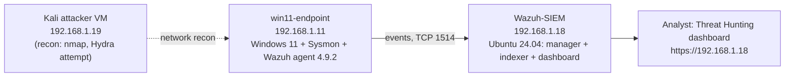
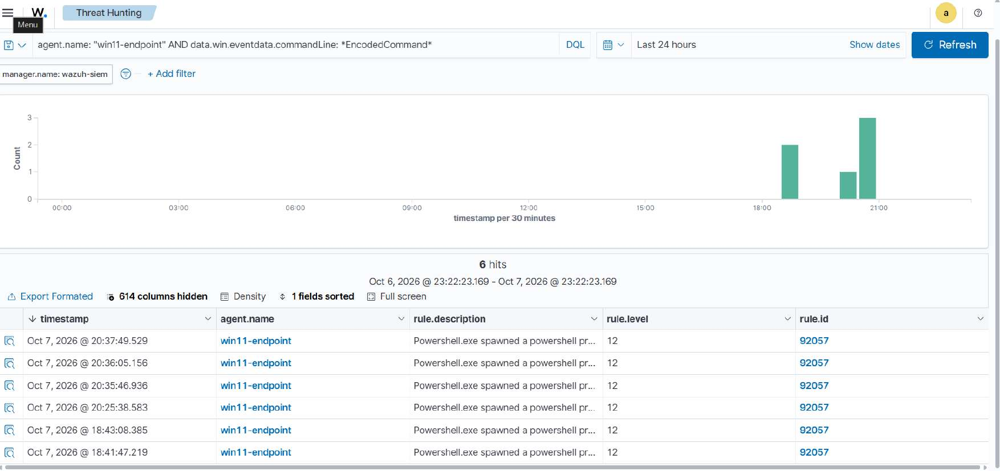
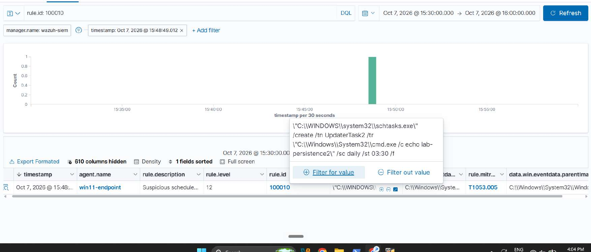

# SOC Home Lab: Wazuh + Sysmon Detection Engineering

A fully local, zero-cost SOC lab built on a laptop with 8 GB RAM. I simulated seven attacker techniques against a Windows 11 endpoint, detected each one in Wazuh using Sysmon telemetry, wrote **two custom detection rules** to close gaps in the default ruleset, and investigated a multi-stage attack chain end to end.

**Stack:** Wazuh (manager + indexer + dashboard) · Sysmon (SwiftOnSecurity config) · VirtualBox · Windows 11 · Ubuntu 24.04 LTS · Kali Linux · MITRE ATT&CK

## Architecture



| VM | Role | OS | Notes |
|---|---|---|---|
| Wazuh-SIEM | SIEM (manager, indexer, dashboard) | Ubuntu Server 24.04 LTS | Bridged, 192.168.1.18 |
| win11-endpoint | Monitored endpoint | Windows 11 Home 25H2 | Sysmon + Wazuh agent 4.9.2, 192.168.1.11 |
| Kali | Attacker / recon | Kali 2026.2 | 192.168.1.19 |

All VMs use bridged networking on one /24 subnet. Addresses come from DHCP, so the endpoint's IP changed over the project (alerts show 192.168.1.15 on Oct 7 and 192.168.1.6 on Oct 9); the agent ID (001) and name stayed the same. The host is an Intel i3-1115G4 with 8 GB RAM, so VMs run one at a time when needed. The Wazuh agent queues events locally and flushes them when the manager reconnects, so no data is lost and timestamps stay accurate.

## Detection coverage

| # | Attack simulated | MITRE ATT&CK | Rule ID | Level | Source |
|---|---|---|---|---|---|
| 1 | Encoded PowerShell (`-EncodedCommand`) | T1059.001 | 92057 | 12 | Default |
| 2 | Account discovery (`net user`, `net localgroup administrators`) | TA0007 (T1087 on 92033) | 92031 / 92033 | 3 | Default |
| 3 | Registry Run key persistence | T1547.001 | 92302 | 6 | Default |
| 4 | Scheduled task persistence (`schtasks /create`) | T1053.005 | **100010** | 12 | **Custom** |
| 5 | Local admin account creation | T1098 | 60154 | 12 | Default |
| 6 | Failed logon burst (8 attempts) | T1110 | 60122 | 5 | Default |
| 7 | LOLBin download (`bitsadmin`) | T1105 | **100012** | 12 | **Custom** |

Evidence for each row is in [`/screenshots/02-detections`](screenshots/02-detections).




## Highlights

- **Custom detections:** rules 100010 and 100012 fill gaps where default rules did not alert. See [`/detection-rules`](detection-rules).
- **Investigation:** a PowerShell → Discovery → Persistence chain worked through alert, triage, timeline, root cause, scope, IOCs and response. See [`/investigation-reports`](investigation-reports).
- **False-positive triage:** rule 92058 (Application Compatibility Database) recurred at level 12. I traced it to a benign `svchost.exe` parent and documented the decision ([evidence](screenshots/03-triage-and-telemetry)).
- **Defense in depth observed:** `certutil` download attempts were blocked by Windows Defender before Sysmon logged them, so I documented the block and switched the test to `bitsadmin`.

## What did not work (and what I learned)

- A Hydra RDP brute force against the endpoint would not connect even with port 3389 confirmed open, so I pivoted to local failed-logon simulation. Failed attempts were generated locally with wrong-credential logons, not from Kali.
- Custom rule 100010 appeared broken for about 3 hours. The rule was correct; the indexer had a corrupted agent database that stopped the agent's events being processed. The fix is in the lessons-learned section of the project report.
- The lab grew to ~95 GB and filled the D: drive. I merged snapshots, trimmed and compacted the virtual disks, and disabled the vulnerability-detection feed. See [`/screenshots/04-lessons-learned`](screenshots/04-lessons-learned).

## Skills demonstrated

SIEM deployment and agent management · Sysmon telemetry tuning · detection engineering (custom Wazuh rules, PCRE2 matching, `wazuh-analysisd -t` validation) · MITRE ATT&CK mapping · alert triage and false-positive analysis · Windows event analysis · incident investigation and reporting · troubleshooting under resource constraints

## Repository layout

```
/docs                    project report and setup notes
/detection-rules         custom rule XML with rationale
/investigation-reports   alert-to-response investigation write-up
/screenshots             evidence, grouped by phase
```

## Safety note

All attacks were simulated on isolated lab VMs I own. The local admin account created for testing (`labadmin`) was deleted at cleanup on 2026-10-09 (`net user labadmin /delete`, itself captured by rule 92033).
